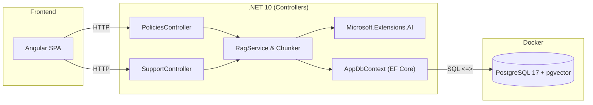

# Software Design Document (SDD) — SmartSupportRag

- **Proyecto:** `SmartSupportRag`
- **Estado:** `Approved`
- **Stack:** .NET 10 (Controllers), EF Core 10, PostgreSQL 17 + `pgvector`, Docker, `Microsoft.Extensions.AI`, Angular.

---

## 1. Problema y Contexto

Una empresa con su propia plataforma de comercio electrónico en constante expansión cuenta con un equipo de soporte y atención al cliente para resolver las dudas de los compradores. 

Actualmente, la operación enfrenta un grave problema de eficiencia: todas las reglas del negocio (políticas de devolución, garantías de productos, tiempos y costos de envío, condiciones generales de uso y restricciones de cuentas) se encuentran dispersas en manuales y documentos PDF de muchas páginas. 

Los agentes de soporte pierden una cantidad crítica de tiempo buscando manualmente información dentro de estos extensos archivos. Esto genera altos tiempos de espera, saturación en los canales de atención y respuestas inconsistentes que impactan negativamente la experiencia del usuario.

Por lo tanto, se requiere un sistema centralizado de recuperación y generación aumentada (RAG) que permita extraer con precisión los fragmentos de texto correspondientes mediante búsqueda vectorial con filtrado por categoría antes de consultar al LLM, garantizando respuestas rápidas, consistentes y respaldadas en la documentación oficial. La base de conocimiento se estructura en 5 categorías principales (`Devoluciones`, `Garantias`, `Envios`, `Terminos` y `Seguridad`).

---

## 2. Alcance

### 2.1 Objetivos
- Ingesta y fragmentación (chunking) de políticas.
- Almacenamiento vectorial en PostgreSQL (`pgvector`) con índice HNSW.
- Búsqueda filtrada sobre 5 categorías base:
  1. `Devoluciones`
  2. `Garantias`
  3. `Envios`
  4. `Terminos`
  5. `Seguridad`
- Endpoint RAG para agentes de soporte.
- Frontend en Angular (Fase Final).

### 2.2 Restricciones
- Solo Controllers tradicionales (`ControllerBase`). Prohibido Minimal APIs.

---

## 3. Arquitectura



---

## 4. Modelo de Datos (EF Core)

### 4.1 `PolicyCategory` (Enum)
```csharp
public enum PolicyCategory
{
    Devoluciones = 1,
    Garantias = 2,
    Envios = 3,
    Terminos = 4,
    Seguridad = 5
}
```

### 4.2 `PolicyDocument`
- `Id` (Guid, PK)
- `Title` (string)
- `Category` (PolicyCategory)
- `CreatedAt` (DateTimeOffset)

### 4.3 `PolicyChunk`
- `Id` (Guid, PK)
- `DocumentId` (Guid, FK)
- `Category` (PolicyCategory, indexado para filtro)
- `ChunkIndex` (int)
- `Content` (string)
- `Embedding` (`Pgvector.Vector`, `vector(1536)`)

---

## 5. Endpoints REST

### `POST /api/policies/seed`
Carga las políticas iniciales divididas en chunks con sus embeddings.

### `POST /api/policies/ingest`
Ingesta un documento nuevo en una categoría.
```json
{
  "title": "Garantías de Laptops",
  "category": "Garantias",
  "content": "Texto de la política..."
}
```

### `POST /api/policies/search`
Retrieval puro. Devuelve los chunks más cercanos por distancia coseno.
```json
{
  "query": "¿Cuántos días tengo para devolver un producto?",
  "category": "Devoluciones",
  "topK": 3
}
```

### `POST /api/support/ask`
Pipeline RAG completo: recupera contexto relevante, arma el prompt y genera respuesta con LLM.
```json
{
  "question": "¿Cubre la garantía una pantalla rota?",
  "category": "Garantias"
}
```

---

## 6. Estructura del Repositorio

```text
smart-support-rag/
├── docs/
│   └── SDD.md
├── src/
│   ├── SmartSupportRag.Api/
│   └── smart-support-ui/ (Angular)
├── docker-compose.yml
├── AGENTS.md
└── README.md
```
