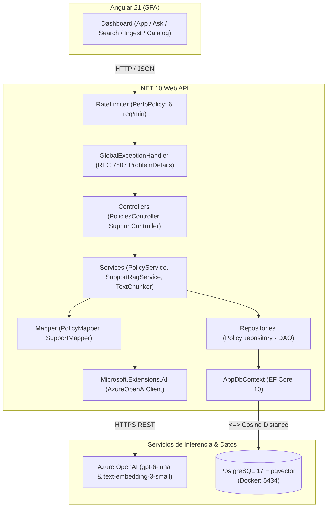

# Software Design Document (SDD) — SmartSupportRag

- **Proyecto:** `SmartSupportRag`
- **Estado:** `Approved & Completed (Production Ready)`
- **Stack:** .NET 10 (Controllers), EF Core 10, PostgreSQL 17 + `pgvector`, Docker, `Microsoft.Extensions.AI` (`Azure.AI.OpenAI` v2), Angular 21.

---

## 1. Problema y Contexto

Una empresa con su propia plataforma de comercio electrónico cuenta con un equipo de soporte y atención al cliente para resolver las dudas de los compradores sobre políticas del negocio (devoluciones, garantías, envíos, términos legales y seguridad de cuentas).

Para evitar tiempos de espera y respuestas inconsistentes por búsqueda manual en documentos dispersos, se diseñó este sistema centralizado de recuperación y generación aumentada (RAG) empresarial. Permite extraer con precisión los fragmentos oficiales mediante búsqueda vectorial semántica por distancia coseno con opción de filtrado explícito por categoría antes de consultar al LLM (`gpt-6-luna`), garantizando respuestas rápidas, empáticas, consistentes y respaldadas con citas oficiales.

---

## 2. Alcance del Sistema

### 2.1 Objetivos Implementados
- Ingesta dinámica y fragmentación inteligente (`TextChunker` de 600 caracteres con 100 de solapamiento).
- Almacenamiento vectorial en PostgreSQL 17 (`pgvector`) con índice HNSW (`vector_cosine_ops`) y embeddings de 1536 dimensiones (`text-embedding-3-small`).
- Búsqueda semántica con filtrado por las 5 categorías base:
  1. `Devoluciones`
  2. `Garantias`
  3. `Envios`
  4. `Terminos`
  5. `Seguridad`
- Asistente RAG con prompt anclado (*grounding*) estricto anti-alucinaciones y citación de fuentes oficiales.
- Catálogo paginado de políticas registradas con inspección detallada de chunks.
- Resiliencia operacional: Rate Limiting por IP, manejo global de excepciones RFC 7807 (`ProblemDetails`) y exclusión mutua (`SemaphoreSlim`).
- Dashboard SPA en Angular 21 con diseño limpio, responsivo y sin texto de relleno.

### 2.2 Restricciones Técnicas
- Solo Controllers tradicionales (`ControllerBase`). Prohibido Minimal APIs.
- DTOs definidos como clases tradicionales (`class`) con propiedades `{ get; set; }` (un archivo por contrato).
- Mapeo manual estático desacoplado en capa `Mapper/` sin librerías de reflexión.

---

## 3. Arquitectura del Sistema



---

## 4. Modelo de Datos (EF Core & pgvector)

### 4.1 `PolicyCategory` (Enum)
```csharp
public enum PolicyCategory
{
    Devoluciones = 1,
    Garantias = 2,
    Envios = 3,
    Terminos = 4,
    Seguridad = 5
}
```

### 4.2 `PolicyDocument`
- `Id` (Guid, PK)
- `Title` (string)
- `Category` (PolicyCategory)
- `CreatedAt` (DateTimeOffset)
- `Chunks` (ICollection<PolicyChunk>)

### 4.3 `PolicyChunk`
- `Id` (Guid, PK)
- `DocumentId` (Guid, FK)
- `Category` (PolicyCategory, indexado para filtrado)
- `ChunkIndex` (int)
- `Content` (string)
- `Embedding` (`Pgvector.Vector`, `vector(1536)`)
- **Índice de Base de Datos:** HNSW sobre `Embedding` usando `vector_cosine_ops`.

---

## 5. Endpoints REST

| Método | Ruta | Descripción | Rate Limit |
| :--- | :--- | :--- | :--- |
| `POST` | `/api/policies/seed` | Carga e indexa las 5 políticas iniciales de forma idempotente con protección `SemaphoreSlim`. | Libre |
| `GET` | `/api/policies` | Lista paginada de políticas registradas con conteo y detalle de fragmentos. | Libre |
| `POST` | `/api/policies/ingest` | Ingesta y vectoriza en caliente una nueva política oficial. | 6 req/min |
| `POST` | `/api/policies/search` | Búsqueda vectorial semántica pura por distancia coseno (`topK`, categoría opcional). | 6 req/min |
| `POST` | `/api/support/ask` | Pipeline RAG asistencial: retrieval semántico + generación fundamentada con `gpt-6-luna`. | 6 req/min |

---

## 6. Mecanismos de Robustez y Resiliencia

1. **Manejo Global de Excepciones:** `GlobalExceptionHandler` traduce errores del runtime y del cliente de Azure a respuestas estándar RFC 7807 `ProblemDetails` sin exponer trazas de ejecución.
2. **Rate Limiting Granular:** Protección por IP en endpoints de inferencia (`/ask`, `/search`, `/ingest`) evitando saturación o agotamiento de cuota de Azure OpenAI.
3. **Exclusión Mutua Concurrente:** `SemaphoreSlim(1, 1)` en `PolicyService.SeedAsync` para neutralizar *race conditions* ante ejecuciones simultáneas.
4. **Cancelación Reactiva en UI:** `Subscription.unsubscribe()` al cambiar filtros o paginación en el catálogo para evitar inconsistencias por respuestas fuera de orden.
5. **Experiencia Limpia:** UI en CSS nativo sin frameworks pesados, acordeón de fuentes colapsable, botón de copiado con confirmación visual reactiva y sin placeholders de relleno.

---

## 7. Estructura del Repositorio

```text
smart-support-rag/
├── docs/
│   └── SDD.md
├── src/
│   ├── SmartSupportRag.Api/
│   │   ├── Controllers/
│   │   │   ├── PoliciesController.cs
│   │   │   └── SupportController.cs
│   │   ├── DTOs/
│   │   │   ├── Policies/
│   │   │   └── Support/
│   │   ├── Services/
│   │   │   ├── TextChunker.cs
│   │   │   ├── PolicyService.cs
│   │   │   └── SupportRagService.cs
│   │   ├── Repositories/
│   │   │   ├── IPolicyRepository.cs
│   │   │   └── PolicyRepository.cs
│   │   ├── Mapper/
│   │   │   ├── PolicyMapper.cs
│   │   │   └── SupportMapper.cs
│   │   ├── Middleware/
│   │   │   └── GlobalExceptionHandler.cs
│   │   ├── Data/
│   │   │   ├── AppDbContext.cs
│   │   │   └── SeedData.cs
│   │   ├── Entities/
│   │   └── Program.cs
│   └── smart-support-ui/ (Angular 21)
│       └── src/app/
│           ├── components/
│           │   ├── ask-support/
│           │   ├── policies-catalog/
│           │   ├── search-policies/
│           │   └── ingest-policy/
│           ├── models/
│           ├── services/
│           ├── app.ts
│           ├── app.html
│           └── app.css
├── docker-compose.yml
├── AGENTS.md
└── README.md
```
